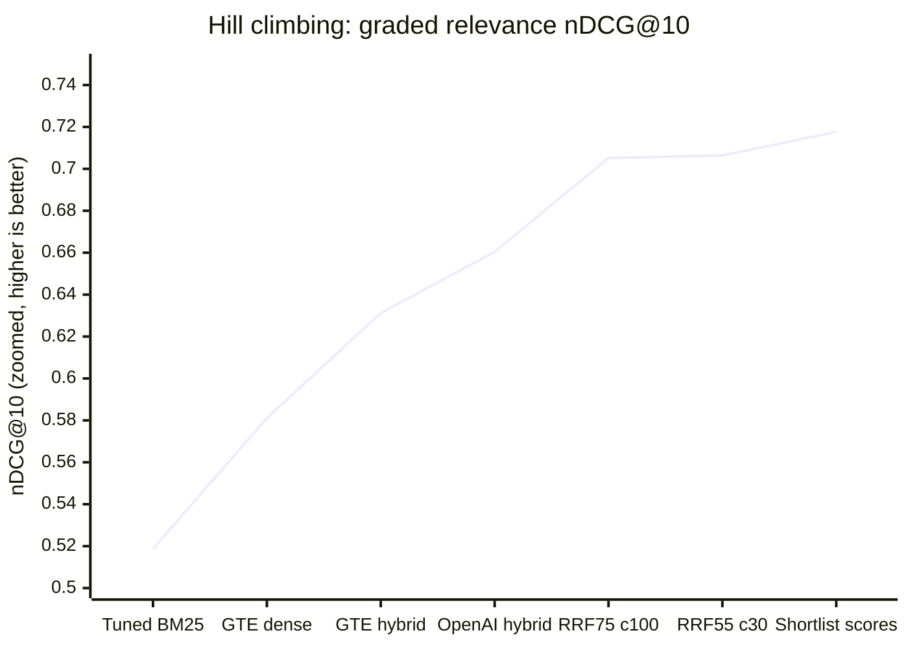
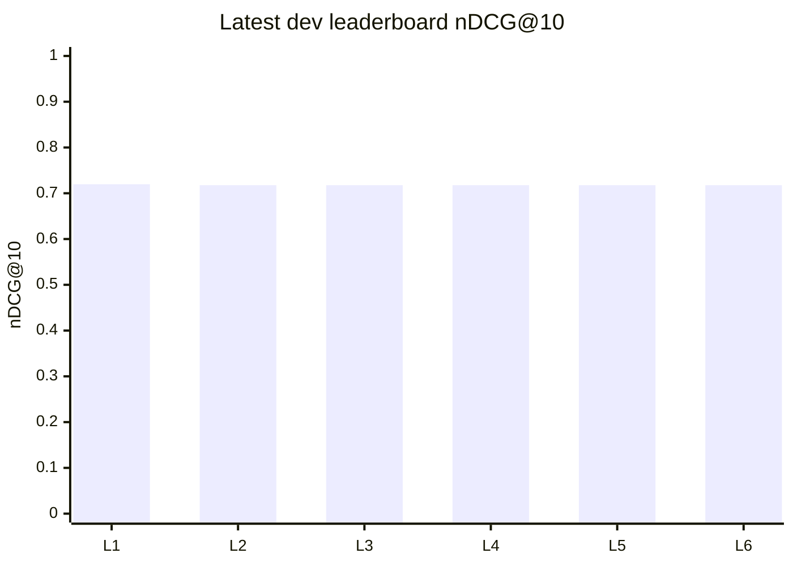

# Search quality charts

*Generated by `python -m arxiv_search.evaluate.baseline_promotion`; do not edit by hand.*

## Hill climbing: major comparable milestones

Every point is rescored against the **same frozen 3,294-pair dev label snapshot**, 100 dev queries, 23,304 searchable papers. These are selected milestones, not every trial, independent experiments, or equally spaced dates. The x-axis is milestone order. **Zoomed linear y-axis: 0.50-0.75, not zero-based.** This focuses on score changes, not their magnitude relative to zero. All plotted top10s are fully judged; no pilot/test scores are mixed in.

**First plotted baseline to current: 0.5187 to 0.7176 (+0.1988 nDCG, +38.3% relative).** The first point is tuned BM25, not the original plain-BM25 control, whose graded coverage is incomplete. Use a linear scale: nDCG is a bounded relevance score, not a quantity spanning orders of magnitude; a log axis would obscure additive improvements.

| Milestone | Saved identity | nDCG@10 | Step gain | Source MRR@10 | Source R@10 |
|---|---|---|---|---|---|
| Tuned BM25 | `bm25+exact+stems+authors+title2x+k1=0.8,b=0.75` | 0.5187 | - | 0.5687 | 71% |
| GTE dense | `dense-gte-small` | 0.5811 | +0.0624 | 0.5254 | 71% |
| GTE hybrid | `hybrid-gte-small+rrf+w=0.5+c=10` | 0.6312 | +0.0501 | 0.6350 | 80% |
| OpenAI hybrid | `hybrid-openai-large+rrf+w=0.5+c=10` | 0.6604 | +0.0291 | 0.6534 | 84% |
| RRF75 c100 | `fusion-rrf+w=0.75+d=100+c=100` | 0.7052 | +0.0448 | 0.6181 | 84% |
| RRF55 c30 | `fusion-rrf+w=0.55+d=100+c=30` | 0.7064 | +0.0012 | 0.6459 | 86% |
| Shortlist scores | `fusion-shortlist+a=1+d=500` | 0.7176 | +0.0112 | 0.6967 | 86% |

**Reading the curve:** big earlier jumps came from complementary lexical/semantic retrieval and better embeddings. The 75%-RRF point was a challenger, not an approved baseline. The balanced RRF55% point recovered known-paper ranks. The current shortlist-score baseline improves ordering while preserving its top10 membership. These steps also change other parameters, so step differences are not isolated causal effects of one feature.

## Latest fully judged leaderboard leaders

Labels L1 onward below are chart keys, not separate system names. The top five ranked systems are shown, plus the approved baseline if it falls outside those five. Exact score ties use stable system IDs for ordering; a different ordinal rank within a tie is not a quality change. Highest nDCG does not automatically mean best balanced baseline. Unlike the milestone line, these bars keep a zero baseline so their lengths do not exaggerate small differences; use the table for exact scores.

| Chart key / rank | Ranker | nDCG@10 | Source MRR@10 | R@10 | Status |
|---|---|---|---|---|---|
| L1 / #1 | Max-normalized scores; 75% semantic / 25% lexical; depth 500 | 0.7197 | 0.6916 | 82% | experiment / control |
| L2 / #2 | concatenated title + abstract control; 75% baseline 31/(30+rank) + 25% field signal; reorder frozen baseline100 | 0.7176 | 0.6967 | 86% | experiment / control |
| L3 / #3 | separate title 25% / abstract 75%; 75% baseline 31/(30+rank) + 25% field signal; reorder frozen baseline100 | 0.7176 | 0.6967 | 86% | experiment / control |
| L4 / #4 | separate title 50% / abstract 50%; 75% baseline 31/(30+rank) + 25% field signal; reorder frozen baseline100 | 0.7176 | 0.6967 | 86% | experiment / control |
| L5 / #5 | separate title 75% / abstract 25%; 75% baseline 31/(30+rank) + 25% field signal; reorder frozen baseline100 | 0.7176 | 0.6967 | 86% | experiment / control |
| L6 / #6 | RRF55%/c30/depth100 selects top10; order by max-score 75% semantic / 25% lexical at depth 500; preserve tail | 0.7176 | 0.6967 | 86% | **APPROVED BASELINE** |

## Where the next big jump would have to come from

- Current nDCG: **0.7176**.
- Perfect label-aware ordering of the **same selected ten papers** reaches only **0.7790** on this snapshot. This is a diagnostic oracle, not a measured model or a prediction of achievable gains.
- Current shortlist contains the source in **86/100** queries. The raw lexical/semantic union contains it in **97/100** at depth100 per retriever and **100/100** at depth500. Candidate availability is not final ranking quality.
- Of 1000 selected results, **311 are grade0**, 423 grade1, and 266 grade2. A fixed shortlist cannot replace the grade0s.

Next hypotheses: improve candidate selection with query-document interaction or better query/document representations, rather than endlessly tuning global fusion weights. Learned/LLM reranking remains a separate future decision, not deployed here. More independent evaluation is also needed: 100 synthetic dev queries and a calibrated LLM judge are not proof of generalization. The held-out 300 queries remain untouched.

## Reproducibility and cautions

- Current approved baseline: `fusion-shortlist+a=1+d=500` (Decision36).
- Label snapshot: `score-fusion-dev/labels.json`; SHA256 `9ea51e45ea7c5329a90f3021516fd143049894440c47b50cdafbc6eb543fc32a`.
- Original plain-BM25 graded coverage is incomplete, so it is excluded from the hill curve.
- Frozen experiment reports retain their original controls; only the unified leaderboard uses the latest working baseline for paired differences.
- All intervals elsewhere are exploratory after repeated dev selection. No fresh-human validation or held-out claim is implied.
- Charts use Mermaid, rendered by GitHub; the tables are an exact readable fallback.
- [Full leaderboard](05-results.md#unified-dev-scorecard)
- [Promotion and loss findings](03-findings.md#23-rankscore-experiments-and-recall-preserving-baseline)
- [Machine-readable promotion/headroom audit](../data/results/baseline-promotion-dev/report.json)
