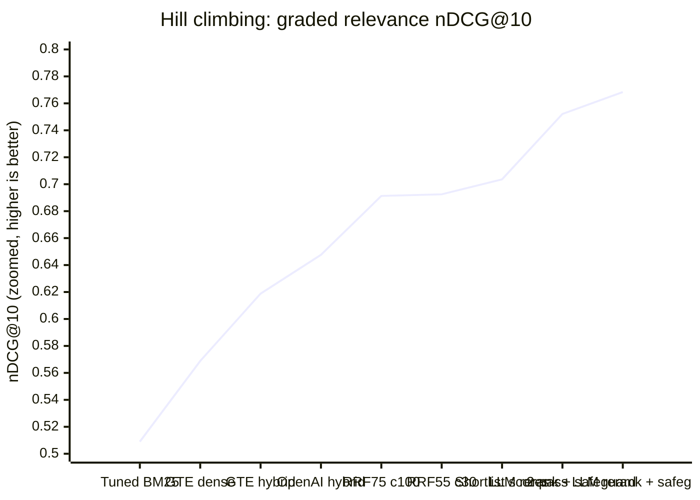
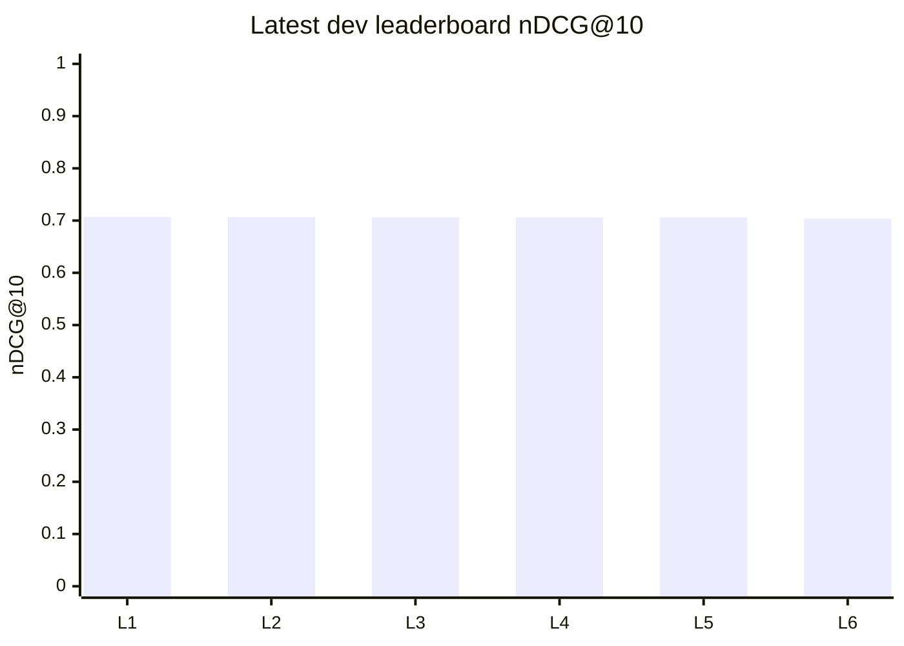
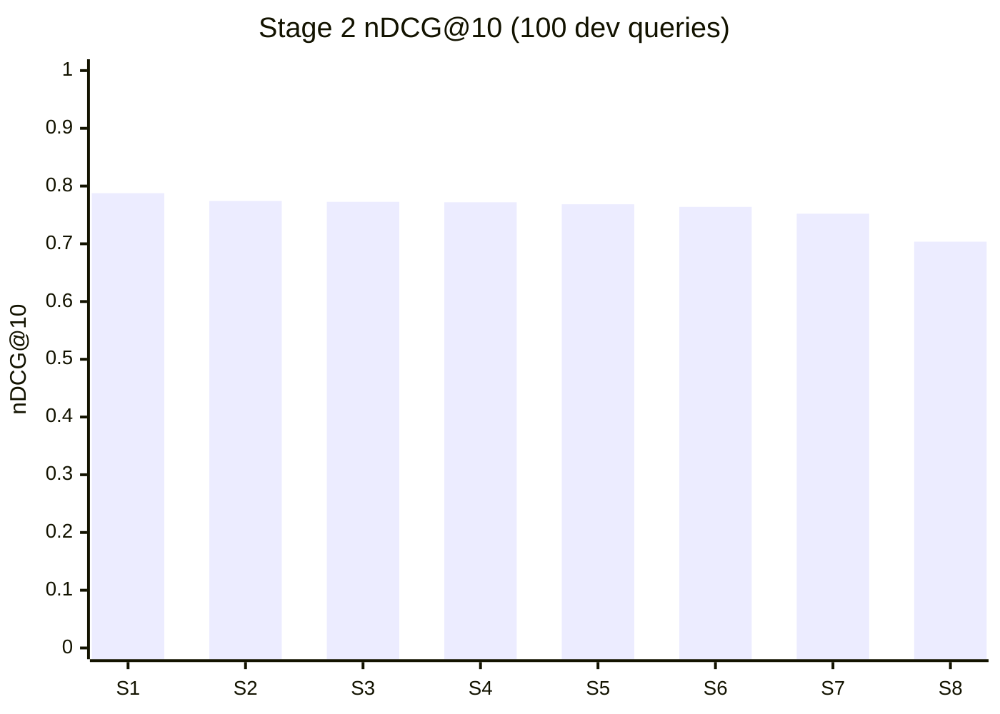

# Search quality charts

*Generated by `python -m arxiv_search.evaluate.baseline_promotion`; do not edit by hand.*

## Hill climbing: major comparable milestones

Every point is rescored against the **same 3,533-pair dev label set (`shared-labels/labels-d46.json`)**, 100 dev queries, 23,304 searchable papers. Stage 1 points are retrieval baselines and turning points; the Stage 2 point adds the LLM reranker on top of the current retrieval baseline. These are selected milestones, not every trial, independent experiments, or equally spaced dates. The x-axis is milestone order. **Zoomed linear y-axis: 0.50-0.80, not zero-based.** This focuses on score changes, not their magnitude relative to zero. All plotted top10s are fully judged; no pilot/test scores are mixed in. Scores shifted down slightly from older versions of this page when reranker top-10 grades joined the shared labels (167 in Decision45, 72 in Decision46); the curve's shape is unchanged.

**First plotted baseline to current: 0.5090 to 0.7684 (+0.2594 nDCG, +51.0% relative); retrieval alone reaches 0.7036, the reranker adds +0.0649.** The first point is tuned BM25, not the original plain-BM25 control, whose graded coverage is incomplete. Use a linear scale: nDCG is a bounded relevance score, not a quantity spanning orders of magnitude; a log axis would obscure additive improvements.

| Stage | Milestone | Saved identity | nDCG@10 | Step gain | Source MRR@10 | Source R@10 |
|---|---|---|---|---|---|---|
| 1 retrieval | Tuned BM25 | `bm25+exact+stems+authors+title2x+k1=0.8,b=0.75` | 0.5090 | - | 0.5687 | 71% |
| 1 retrieval | GTE dense | `dense-gte-small` | 0.5688 | +0.0598 | 0.5254 | 71% |
| 1 retrieval | GTE hybrid | `hybrid-gte-small+rrf+w=0.5+c=10` | 0.6188 | +0.0499 | 0.6350 | 80% |
| 1 retrieval | OpenAI hybrid | `hybrid-openai-large+rrf+w=0.5+c=10` | 0.6476 | +0.0288 | 0.6534 | 84% |
| 1 retrieval | RRF75 c100 | `fusion-rrf+w=0.75+d=100+c=100` | 0.6913 | +0.0438 | 0.6181 | 84% |
| 1 retrieval | RRF55 c30 | `fusion-rrf+w=0.55+d=100+c=30` | 0.6925 | +0.0012 | 0.6459 | 86% |
| 1 retrieval | Shortlist scores | `fusion-shortlist+a=1+d=500` | 0.7036 | +0.0111 | 0.6967 | 86% |
| 2 reranking | LLM rerank + safeguard | `llm-mini-score-pilot+d=50+rrf-baseline+c=30` | 0.7521 | +0.0485 | 0.7197 | 87% |
| 2 reranking | 2-pass LLM rerank + safeguard | `llm-mini-score-pilot+d=50+avg2+rrf-baseline+c=30` | 0.7684 | +0.0163 | 0.7232 | 87% |

**Reading the curve:** big earlier jumps came from complementary lexical/semantic retrieval and better embeddings. The 75%-RRF point was a challenger, not an approved baseline. The balanced RRF55% point recovered known-paper ranks. The current shortlist-score baseline improves ordering while preserving its top10 membership. These steps also change other parameters, so step differences are not isolated causal effects of one feature. The reranker step is one of the largest on the curve. Without the safeguard, the top-50 reranker scores higher on nDCG but pushes source papers down; the safeguard keeps most of the gain and improves source MRR.

## Latest scores: Stage 1 retrieval leaders

Labels L1 onward below are chart keys, not separate system names. The top five ranked retrieval systems are shown, plus the retrieval baseline if it falls outside those five. Exact score ties use stable system IDs for ordering; a different ordinal rank within a tie is not a quality change. Highest nDCG does not automatically mean best balanced baseline. Unlike the milestone line, these bars keep a zero baseline so their lengths do not exaggerate small differences; use the table for exact scores.

| Chart key / rank | Ranker | nDCG@10 | Source MRR@10 | R@10 | Status |
|---|---|---|---|---|---|
| L1 / #1 | 25% lexical / 75% semantic; 10% title / 90% abstract; 0% combined-text anchor; candidate-max normalization; reorder baseline top10 only, preserve tail | 0.7071 | 0.6985 | 86% | experiment / control |
| L2 / #2 | 25% lexical / 75% semantic; abstract only; 0% combined-text anchor; candidate-max normalization; reorder baseline top10 only, preserve tail | 0.7067 | 0.6799 | 86% | experiment / control |
| L3 / #3 | 25% lexical / 75% semantic; 25% title / 75% abstract; 50% combined-text anchor; candidate-max normalization; reorder baseline top10 only, preserve tail | 0.7061 | 0.6940 | 86% | experiment / control |
| L4 / #4 | separate title 25% / abstract 75%; max-score25% lexical / 75% field semantic; reorder baseline top10 only, preserve tail | 0.7061 | 0.7047 | 86% | experiment / control |
| L5 / #5 | 25% lexical / 75% semantic; 25% title / 75% abstract; 0% combined-text anchor; candidate-max normalization; reorder baseline top10 only, preserve tail | 0.7061 | 0.7047 | 86% | experiment / control |
| L6 / #13 | RRF55%/c30/depth100 selects top10; order by max-score 75% semantic / 25% lexical at depth 500; preserve tail | 0.7036 | 0.6967 | 86% | **APPROVED BASELINE** (retrieval) |

## Latest scores: Stage 2 reranking (retrieval + reranker)

Every row reorders the same retrieval-baseline candidates for all 100 dev queries. Δ is paired against the retrieval baseline; the noise band comes from re-sending identical requests (Decision44).

| Chart key | System | nDCG@10 | Δ vs retrieval baseline | Source MRR@10 | R@10 | LLM $/query | Status |
|---|---|---|---|---|---|---|---|
| S1 | `llm-mini-score-pilot+d=50+avg2` | 0.7877 | +0.084 [+0.057, +0.111] | 0.6863 | 88% | $0.0275 | experiment |
| S2 | `llm-mini-score-pilot+d=50+blend-rank-prior+b=2+c=30` | 0.7742 | +0.071 [+0.046, +0.096] | 0.6860 | 88% | $0.0138 | experiment |
| S3 | `llm-mini-score-pilot+d=50` | 0.7726 | +0.069 [+0.044, +0.095] | 0.6775 | 88% | $0.0138 | experiment |
| S4 | `llm-mini-score-pilot+d=50+blend-rank-prior+b=3+c=30` | 0.7719 | +0.068 [+0.046, +0.091] | 0.6966 | 89% | $0.0138 | experiment |
| S5 | `llm-mini-score-pilot+d=50+avg2+rrf-baseline+c=30` | 0.7684 | +0.065 [+0.048, +0.081] | 0.7232 | 87% | $0.0275 | **APPROVED BASELINE** (reranking) |
| S6 | `llm-mini-score-pilot+d=50+blend-rank-prior+b=4+c=30` | 0.7639 | +0.060 [+0.040, +0.081] | 0.7023 | 89% | $0.0138 | experiment |
| S7 | `llm-mini-score-pilot+d=50+rrf-baseline+c=30` | 0.7521 | +0.049 [+0.034, +0.063] | 0.7197 | 87% | $0.0138 | experiment |
| S8 | `fusion-shortlist+a=1+d=500` | 0.7036 | — | 0.6967 | 86% | $0.0000 | **APPROVED BASELINE** (retrieval, no reranker) |

## Where the next big jump would have to come from

- Retrieval baseline nDCG: **0.7036** (diagnostics below are for Stage 1, the candidates the reranker sees).
- Perfect label-aware ordering of the **same selected ten papers** reaches only **0.7632** on this snapshot. This is a diagnostic oracle, not a measured model or a prediction of achievable gains.
- Current shortlist contains the source in **86/100** queries. The raw lexical/semantic union contains it in **97/100** at depth100 per retriever and **100/100** at depth500. Candidate availability is not final ranking quality.
- Of 1000 selected results, **311 are grade0**, 423 grade1, and 266 grade2. A fixed shortlist cannot replace the grade0s.

Next hypotheses: improve candidate selection with query-document interaction or better query/document representations, rather than endlessly tuning global fusion weights. The Stage 2 LLM reranker (Decision45) is the first step past the fixed shortlist: it reorders the top 50 rather than the top 10. More independent evaluation is also needed: 100 synthetic dev queries and a calibrated LLM judge are not proof of generalization. The held-out 300 queries remain untouched.

## Reproducibility and cautions

- Retrieval baseline: `fusion-shortlist+a=1+d=500` (Decision36).
- Reranking baseline: `llm-mini-score-pilot+d=50+avg2+rrf-baseline+c=30` (Decision46): mean of 2 identical LLM passes; LLM scores vary run to run, so its point uses the saved, cached rankings.
- Label snapshot: `shared-labels/labels-d46.json`; SHA256 `7f6145f8443267fef8393cabc10ab7170f3e85538e07e47e80ef2258a8cd10d0`.
- Original plain-BM25 graded coverage is incomplete, so it is excluded from the hill curve.
- Frozen experiment reports retain their original controls; only the unified leaderboard uses the latest working baseline for paired differences.
- All intervals elsewhere are exploratory after repeated dev selection. No fresh-human validation or held-out claim is implied.
- Charts use Mermaid, rendered by GitHub; the tables are an exact readable fallback.
- [Full leaderboard](05-results.md#unified-dev-scorecard)
- [Promotion and loss findings](03-findings.md#23-rankscore-experiments-and-recall-preserving-baseline)
- [Machine-readable promotion/headroom audit](../data/results/baseline-promotion-dev/report.json)
